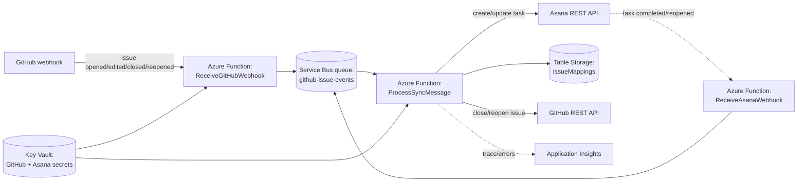

# github-asana-sync

**Status: deployed to Azure and verified end to end (2026-10-16). Two-way
since 2026-10-27:** completing or reopening a task in Asana closes or reopens
the GitHub issue it came from. GitHub → Asana covers issues and pull
requests; Asana → GitHub covers issues only, since a pull request cannot be
merged from Asana. `dotnet test` passes (37/37) locally and in GitHub Actions.
The infrastructure now runs in a real subscription: a signed webhook was
accepted and queued, an unsigned and a wrongly signed one were rejected and
logged, and the queue processor picked the message up and retried it the way
it is meant to.

### What the first real deployment changed

Running the template for the first time found one bug that no amount of
reading would have caught: `AzureWebJobsStorage` was set to the storage
account's blob endpoint instead of a connection string, which would have
stopped the Functions host from starting. Three more only showed up
against live Azure:

- Owning the subscription does not grant data-plane access to Key Vault when
  the vault uses RBAC. The deploying user needs `Key Vault Secrets Officer`
  on the vault, separately from any management-plane role.
- Table Storage rejects `/` in a partition key, and a GitHub repository is
  always `owner/name`. Every lookup came back as `400 Error in query syntax`.
  The fakes the tests run against accept any string, so this could only
  surface against the real service; `IssueMapping.BuildPartitionKey` now
  replaces the characters Table Storage refuses, with tests covering it.
- App Service caches a Key Vault reference, and restarting does not re-read
  it. Updating a secret in the vault looked like it had no effect. The
  references are now versionless, so rotating a secret takes effect without a
  redeployment, and both secrets are only written when a value is passed in.
- The Linux Consumption plan cannot fetch its deployment package with the
  app's managed identity. The template now has Azure mint a read-only service
  SAS during deployment (`listServiceSas`), so the token never passes through
  a parameter or a command line.

Serverless, event-driven sync between GitHub Issues and Asana tasks, built to
show real Azure PaaS services instead of a self-hosted webhook service.

## Why this exists

The existing portfolio project (`Integration Hub — Freshdesk ↔ Asana`) proves
webhook-based integration skills, but it's a self-hosted ASP.NET Core service
with SQLite — no cloud infrastructure involved. This project is meant to prove
the other half: Azure Functions, a message queue, managed secrets and
infrastructure as code, which is what most "Integrationsutvecklare" /
"Azure-utvecklare" job ads in Stockholm actually ask for by name.

## How it will work



The Asana direction reuses the same queue and worker. Its messages carry only
the task GID, because Asana's events do not say what the new value is; the
worker reads the task and the issue and only writes when they disagree. That
check is also the loop guard: closing the issue makes GitHub send a webhook
back, which finds the task already completed and stops there.

1. An HTTP-triggered Function receives GitHub's webhook and does the minimum
   work to validate + drop a message on a **Service Bus** queue. This
   separates "accept the webhook fast" from "do the actual API call" — the
   same reason real integrations use a queue instead of calling straight
   through.
2. A queue-triggered Function does the sync: looks up the id mapping in
   **Table Storage**, calls the other system's REST API, and updates the
   mapping. Failed messages retry automatically and land in the dead-letter
   queue after N attempts instead of silently disappearing.
3. **Key Vault** holds the GitHub and Asana API tokens — Functions read them
   via managed identity, no secrets in config.
4. **Application Insights** traces each message through receive → queue →
   process, so a failed sync is debuggable instead of a mystery.
5. **Bicep** defines the whole resource group (Function App, Service Bus
   namespace, Storage account, Key Vault, Application Insights) so the
   environment stands up with one command and tears down the same way.

## What's built

- `src/GithubAsanaSync.Functions` — .NET isolated worker Functions app.
  - `ReceiveGitHubWebhook` — validates the `X-Hub-Signature-256` HMAC,
    branches on the `X-GitHub-Event` header to parse either an `issues` or a
    `pull_request` payload (`opened`/`edited`/`closed`/`reopened`), queues a
    `SyncMessage`. Always answers GitHub 200 by design (see comment in the
    file) — a bad signature and an ignored action/event look identical from
    the outside.
  - `ProcessSyncMessage` — Service Bus queue trigger. Creates the Asana task
    on first sight of an issue or PR (self-healing: one closed before ever
    being seen still gets created, then marked complete), otherwise updates
    completion state or adds a comment on edit. A merged PR gets a "Merged"
    comment before being completed; a PR closed without merging gets a
    "Closed without merging" comment instead — same completion either way,
    different note on why.
  - `TableIdMappingStore` — one Table Storage row per synced item
    (PartitionKey = repo, RowKey = `{Issue|PullRequest}-{number}` — issues
    and PRs share GitHub's numbering sequence, so the kind is part of the
    key to avoid issue #42 and PR #42 colliding).
  - `AsanaClient` — thin wrapper over Asana's REST API v1.0.
  - `ReceiveAsanaWebhook` — Asana's side. Answers the one-time handshake by
    echoing `X-Hook-Secret` and storing it (Table Storage, since the app's
    Key Vault role is read-only), then checks `X-Hook-Signature` on every
    delivery and queues one message per changed task. Needs the Function
    key, so only someone holding it can perform a handshake.
  - `TaskSyncService` + `GitHubClient` — Asana → GitHub: finds the issue
    through a reverse mapping row, closes or reopens it with a comment saying
    why. Ignores tasks it did not create and tasks that track a pull request.
- `tests/GithubAsanaSync.Tests` — xUnit + Moq, 14 tests. Signature validation
  (valid/tampered/wrong-secret/malformed-header) and the sync branching
  logic (new issue, existing issue, self-healing, edit, PR merged, PR closed
  unmerged) are covered against mocked `IAsanaClient`/`IIdMappingStore` — no
  live Azure or Asana calls in CI. `dotnet test` from the repo root runs
  everything.
- `infra/main.bicep` — Consumption-plan Function App, Service Bus (Basic,
  one queue), Storage account (Functions storage + the mapping table),
  Key Vault (both secrets, resolved into the Function App via its
  system-assigned identity + `Key Vault Secrets User` role — never as plain
  app settings), Application Insights + Log Analytics.
- `.github/workflows/ci.yml` — restore/build/test on push and PR, matching
  the other .NET portfolio project's CI shape.

## Deploying

**Code: automatic.** Every push to `main` that passes the tests is deployed by
the `deploy` job in `.github/workflows/ci.yml`: it publishes the app, uploads
`app.zip` to the `deployments` container and restarts the Function App. It
logs in to Azure with OIDC, so no Azure secret is stored in GitHub. Run
`infra/setup-github-deploy.sh` once to create the trusted Entra app, its two
narrowly scoped roles and the GitHub repository variables.

**Two-way setup, once:** create a fine-grained GitHub token (this repo only,
Issues read/write), copy it and run `infra/set-github-token.sh`, then run
`infra/register-asana-webhook.sh`.

**Infrastructure: by hand**, since the template takes the app secrets:

```
az group create -n rg-github-asana-sync -l swedencentral
az storage container create --name deployments --account-name <storage> --auth-mode login
az storage blob upload --account-name <storage> --auth-mode login -c deployments -n app.zip -f app.zip --overwrite
az deployment group create -g rg-github-asana-sync -f infra/main.bicep \
  -p githubWebhookSecret=<secret> asanaAccessToken=<token> asanaProjectGid=<gid> \
     packageUri=https://<storage>.blob.core.windows.net/deployments/app.zip
```

Build `app.zip` with `dotnet publish -c Release -o out` and zip the contents
of `out`. The deploying user needs `Key Vault Secrets Officer` on the vault
before the template writes its two secrets.

Both secrets are written only when a value is passed in, so re-running the
deployment without them leaves what is already in the vault alone.

Functions runtime is pinned to `.NET 8` in the Bicep template
(`linuxFxVersion: 'DOTNET-ISOLATED|8.0'`) — deliberate, not an oversight: the
Azure Functions Worker SDK rejects `net10.0` outright, so the Functions
project targets `net8.0` while the test project stays on `net10.0`.

## Still open

- [x] Asana → GitHub direction for issues (2026-10-27). Tasks created before
      that date have no reverse mapping and stay one-way.
- [ ] Field changes beyond open/closed (title, assignee) in either direction.
- [ ] Actually deploy `main.bicep` and register the GitHub + Asana webhooks
      against the live endpoint.

## Cost note

Service Bus has no permanent free tier (unlike the Functions Consumption
plan). Use the **Basic** tier and delete the resource group between demos —
at that usage level the real cost is close to zero, but it is not free
indefinitely like the rest of this portfolio.
